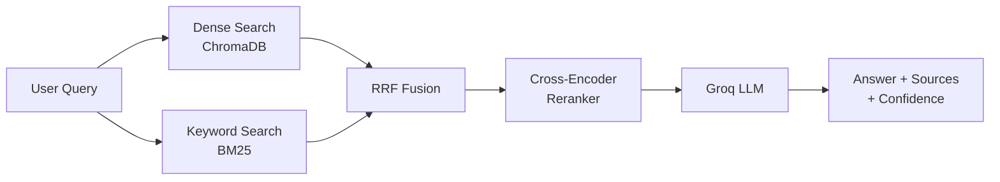

<div align="center">


<a href="https://git.io/typing-svg">
  
</a>

<p>
  <a href="https://linkedin.com/in/udaykumar20/"></a>
  <a href="mailto:saripilliudaykumar@gmail.com"></a>
  <a href="https://github.com/Udayy08"></a>
</p>


</div>

---

## 👨‍💻 About Me

```python
uday = {
    "role"      : "AI Engineer | Software Engineer Intern @ ITJOBXS",
    "education" : "B.Tech CSE @ Lovely Professional University (CGPA 8.38, 2023-2027)",
    "location"  : "Phagwara, Punjab, India 🇮🇳",
    "focus"     : ["Agentic AI", "Hybrid RAG", "LLM Evaluation", "Backend APIs"],
    "currently" : "Building production-style agent workflows with LangGraph & FastAPI",
    "fun_fact"  : "2nd Rank, HackWithVertos 1.0 (24-hour hackathon) ⚡",
}
```

---

## 🔭 What I'm Working On

| | |
|---|---|
| 🤖 **Agentic systems** | Multi-agent workflows with LangGraph, confidence scoring and observability |
| 🔍 **Retrieval quality** | Hybrid search (dense + BM25), RRF fusion, cross-encoder reranking |
| 📏 **Evaluation** | Measuring RAG with RAGAS instead of guessing |
| 🛡️ **Backend** | Authentication, bot detection and reCAPTCHA at ITJOBXS |

---

## 🚀 Featured Projects

### 🧠 [AI SupportOps — Agentic RAG Platform](https://github.com/Udayy08)
> A multi-agent customer-support automation system that retrieves, reasons, and cites its sources.

- **7-node multi-agent workflow** built with **LangGraph**, served via **FastAPI** with **Groq** LLMs
- **Hybrid RAG pipeline:** ChromaDB + BM25 → Reciprocal Rank Fusion → Cross-Encoder reranking
- **Top-1 retrieval accuracy: 62.5% → 77.5% (+15 pts)**
- Confidence scoring, source attribution, **RAGAS** evaluation and workflow observability




---

### 🎥 [VidQuery — YouTube Semantic Search](https://github.com/Udayy08/Youtube_ChatBot)
> Chat with any YouTube video in natural language.

- Transcript processing → chunking → **FAISS** semantic retrieval
- **LangChain + Groq** for context-aware answers and summaries
- HuggingFace embeddings


---

### ❤️ [ECG Scan Classification](https://github.com/Udayy08/normal-abnormal-ecg)
> Deep learning classifier for normal vs abnormal ECG images.

- **MobileNetV2** CNN with image preprocessing and model optimization
- **Flask** backend for uploads and real-time predictions with confidence scores


<details>
<summary><b>📦 More projects</b></summary>
<br>

- 🎙️ [**Blog to Podcast Converter**](https://github.com/Udayy08/BlogtoPodcast): scrape → summarize → text-to-speech (OpenAI, ElevenLabs, Firecrawl, Streamlit)
- 🏠 [**House Price Prediction**](https://github.com/Udayy08/HousePricePrediction): Linear Regression vs Decision Tree vs Random Forest (Scikit-learn)

</details>

---

## 💼 Experience

**Software Engineer Intern — ITJOBXS** · *Aug 2026 – Present · Remote*
- Built a responsive page section for itjobxs.com (HTML, CSS, JavaScript, Bootstrap, PHP, MySQL)
- Worked on user verification and authentication to detect and remove fake bots and posts
- Integrated **Google reCAPTCHA** to block automated activity

---

## 🛠️ Tech Stack

<div align="center">

<br><br>
<br><br>


</div>

**GenAI:** LangChain · LangGraph · RAG · AI Agents · Vector DBs (ChromaDB, FAISS) · Semantic Search · RAGAS · n8n
**CS Fundamentals:** DSA · OOP · Operating Systems · Computer Networks

---

## 📊 GitHub Stats

<div align="center">


</div>

---

## 🏆 Achievements & Learning

- 🥈 **2nd Rank**, HackWithVertos 1.0 (24-hour hackathon)
- 💻 **200+ DSA problems** on LeetCode, GFG and Neocolab
- 🎓 **Advanced RAG**, CampusX (Sept 2026)
- 🧪 **Generative AI Training**, MindForge Labs & LPU (May 2026)
- 🤖 **Certified Essentials Automation Professional**, Automation Anywhere (Nov 2025)
- 🔒 **Privacy and Security in Media**, NPTEL (Apr 2025)

---

## 📬 Let's Connect

<div align="center">

Open to **AI/ML and Software Engineering roles**, collaborations and open-source work.

**saripilliudaykumar@gmail.com** · [LinkedIn](https://linkedin.com/in/udaykumar20/) · [GitHub](https://github.com/Udayy08)

<br>

<i>"Build things that matter. Ship fast. Learn faster."</i>


</div>
